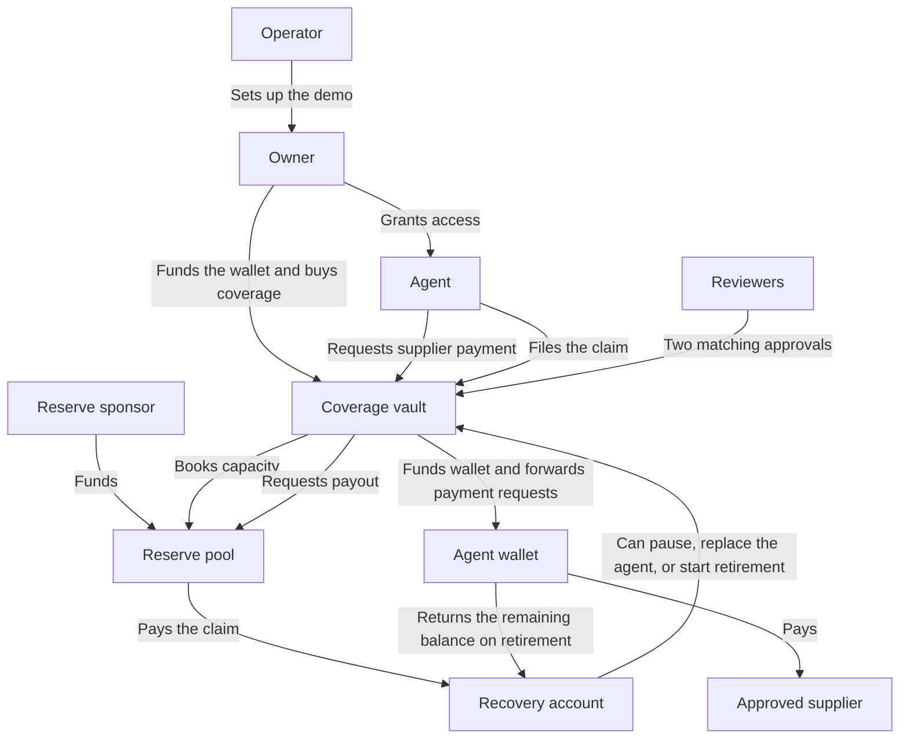

# AgSurance

AgSurance gives AI agents a payment account with loss coverage on NEAR testnet. The owner chooses a supplier and sets a spending limit. The agent can pay that supplier from its own runtime. If the demo records a loss, reviewers examine the transfer before a separate reserve pays the claim.

[Open the hosted demo](https://agsurance.vercel.app/demo) · [Open the public replay](https://agsurance.github.io/agsurance-fe/) · [View the 0.25 NEAR payout receipt](https://testnet.nearblocks.io/txns/6EUqDWKJxeoTz8MXnWiCpS8cGGyuguvrhHuLmFqtPtDq/receipts) · [Read the Rust contracts](https://github.com/AgSurance/agsurance-sc)

## Try AgSurance

Open the public replay to follow a recorded claim without a wallet. Open the payout receipt to see the amount and the recipient on NEAR testnet.

If you have a demo invite, enter the code on the hosted `/demo` page. The hosted console can buy a policy, simulate a loss, submit a claim as the demo owner, and pay it after two approvals. It currently uses the original testnet contracts. Use a fresh local setup for the agent CLI, credential replacement, and recovered claim funds.

## How the demo works

A policy records the supplier, spending limit, and coverage terms. A premium is the price of a period of coverage. The reserve holds funds for claims. A receipt records the result of a transaction on NEAR.



The operator sets up the demo accounts. A sponsor funds the reserve. The reviewers record their votes through the vault. The registered recovery account receives the payout. It can also stop the agent, authorize a replacement, or recover the remaining wallet balance through a separate action.

## How AgSurance uses NEAR

| NEAR feature | What it does in AgSurance |
| --- | --- |
| Function-call access keys | A function-call key can call specific methods. The agent uses one to request supplier payments, renew coverage, and file claims. |
| Named accounts | The demo uses separate accounts for the agent, wallet, vault, reserve, and reviewers. |
| Rust contracts | The vault opens policies and records votes. The wallet enforces spending rules. The reserve sets aside funds and pays claims. |
| Calls between contracts | The vault reserves funds before it funds the wallet. The vault activates coverage after the wallet confirms funding. |
| NEAR RPC and receipts | NEAR RPC lets the reviewer client read transaction results. The client reads the transfer receipt. The vault requires matching votes on that receipt. |
| NEAR Connect | The owner can sign with a funded testnet wallet in the local console. |

The spending controls and the ability to revoke access fit the AI Security & Defense track. Supplier payments and renewals from the agent runtime fit the Agent Economy track.

## Run the testnet demo

Install Bun and the Rust toolchain. If you plan to use your own funded testnet wallet, set `AGSURANCE_POLICY_OWNER` before setup. Use a named `.testnet` account.

Run these commands in a fresh directory. The setup script deploys fresh contracts to NEAR testnet and writes the local signing configuration to `.env.local`. Keep that file private. Use it to resume the same setup after a partial failure.

```sh
git clone https://github.com/AgSurance/agsurance-sc.git
git clone https://github.com/AgSurance/agsurance-fe.git
cd agsurance-sc
rustup target add wasm32-unknown-unknown
cargo build --locked --release --target wasm32-unknown-unknown
cd ../agsurance-fe
bun install --frozen-lockfile
bun scripts/setup-testnet.ts ../agsurance-sc/target/wasm32-unknown-unknown/release
bun run dev --hostname 127.0.0.1
```

Open [the local console](http://127.0.0.1:3000/demo). If you set `AGSURANCE_POLICY_OWNER`, connect that wallet through NEAR Connect. Otherwise, the console uses the generated demo signer. The local signing route accepts requests from the loopback console.

1. Select `Fund wallet and buy policy`. Choose the demo supplier and set the limit to 0.05 NEAR. Wait until the policy is active. If capacity is unavailable or funding fails, the vault refunds checkout. The dashboard offers a retry if the refund fails.
2. Run the following command from `agsurance-fe`. Paste the public key into `Connect Agent`. Keep the private key file in the agent runtime. Wait for the console to show that the agent is connected.

   ```sh
   bun scripts/agent.ts init .agsurance-agent.key
   ```

3. Replace `<vault.testnet>` and `<supplier.testnet>` with the account IDs from the dashboard. Pay the supplier from the agent runtime.

   ```sh
   bun scripts/agent.ts status <vault.testnet>
   bun scripts/agent.ts pay <vault.testnet> .agsurance-agent.key <supplier.testnet> 0.05
   ```

4. Select `Simulate 0.3 NEAR loss` in the console. Wait until the loss appears in the transaction trail. Submit the claim from the agent runtime.

   ```sh
   bun scripts/agent.ts submit-claim <vault.testnet> .agsurance-agent.key
   ```

5. Open `Claim review`. Select `Verify loss receipt`. Approve the claim as reviewer 1. Approve it as reviewer 2.
6. Select **Pay claim**. Open **Verify final payout receipt** after the transfer completes.
7. To try the recovery variant, use a separate run. In **Recovered claim funds**, attach 0.05 NEAR from the registered recovery account while the claim is in review or approved, before starting payout. Select **Send recovered funds**, then **Pay claim** after approval. The reserve pays 0.20 NEAR. Distribute the recorded 0.05 NEAR separately to the recovery account.

The console stores confirmed payout links by vault and policy in `.agsurance-demo`. The agent keeps its private key in its own runtime. The wallet, vault, and pool contracts are deployed without account access keys.

### What to look for

| Action | Expected result | Where to look |
| --- | --- | --- |
| Buy the policy | The wallet receives 0.35 NEAR. The reserve sets aside 0.40 NEAR. | Policy status and reserve balances |
| Pay the supplier | The approved supplier receives 0.05 NEAR. | Agent command output and NEAR testnet receipt |
| Simulate the loss | A test transfer of 0.30 NEAR appears. | Transaction trail and loss receipt |
| Review the claim | Two reviewer accounts approve the same receipt. | Claim review |
| Pay the claim | The recovery account receives 0.25 NEAR. | [Example payout receipt](https://testnet.nearblocks.io/txns/6EUqDWKJxeoTz8MXnWiCpS8cGGyuguvrhHuLmFqtPtDq/receipts) or the receipt from your run |

The public replay also links to a [second payout after a retry](https://testnet.nearblocks.io/txns/6SMehBKzziTS9bvU5SHuATrRK7m9Fc3qZyzQMqwX5enz/receipts) and a [refunded checkout](https://testnet.nearblocks.io/txns/7YsGxdjqYoYsyDQ8WFYPGWXRok78tw1Nk9GbXXCR8Gw7/receipts). A [separate transaction](https://testnet.nearblocks.io/txns/2VbVT7Qh6QnpoT2qNjbj9pWuVLLzXBqfRZMUSF2siDob) shows a claim filed from the agent CLI.

## Check the frontend

The frontend uses Next.js App Router, TypeScript, and Tailwind CSS. Run these checks from `agsurance-fe`.

```sh
bun run lint
bun run build
```

## Business model and reserve economics

The first customers are teams that give agents a budget for recurring payments. Examples include payments for APIs, computing, and other digital services. The team pays for coverage when it funds the wallet. The agent can pay later premiums from the wallet balance.

The demo uses NEAR for the wallet balance, premiums, reserve, and payout. The initial payment is 0.36 NEAR before network fees. Of that amount, 0.35 NEAR funds the wallet and 0.01 NEAR pays the first premium. The owner also funds the agent subaccount with 0.10 NEAR when they connect the agent.

The reserve sponsor supplies the capital for payouts. The pool sets aside 0.40 NEAR for the demo policy. The deductible is the part of a covered loss that the owner pays. The 0.30 NEAR loss minus the 0.05 NEAR deductible gives a 0.25 NEAR payout.

The optional capital pilot credits earned premiums to the operator and capital providers. Capital providers bear losses from paid claims and receive their share of any staking rewards after the funds return to the reserve. The pilot also supports cashback for a fully paid term without a coverage gap. The default hosted demo uses the standard reserve.

## Demo scope

The local console and agent run on NEAR testnet. The loss comes from a test function. Two of three reviewer accounts must approve the same receipt before the vault can request payment. The public replay shows a recorded run. The hosted console signs new transactions with accounts prepared for each invite. A fresh local deployment enables the latest contract and CLI features.

## Renew coverage and recover the wallet balance

The demo uses four periods of seven days by default. Each renewal costs 0.01 NEAR. The dashboard and CLI report when payment opens, the due time, and known blockers. Run this command from `agsurance-fe` with the vault account and the agent key file. It skips when no premium is due.

```sh
bun scripts/agent.ts renew <vault.testnet> .agsurance-agent.key
```

A late premium resumes coverage from confirmation and keeps the same policy limit. Supplier payments pause while coverage has lapsed. If the operating balance is low, attach funds through the wallet's payable `top_up` method. To shorten a fresh test run, set `AGSURANCE_TEST_WINDOW_SECONDS=90` before setup.

If the CLI returns `pending_confirmation`, run `bun scripts/agent.ts reconcile <vault.testnet>` from the same directory. The local console offers **Check transaction**. Both check the original transaction hash before retrying a signed request.

`agent.ts status VAULT` and `GET /api/demo` share a `status` object. It includes policy and checkout IDs, coverage, the filing deadline, renewal, action availability, and pending confirmation. Local API callers send `expectedPolicyId` and, for checkout refunds, `expectedCheckoutId`. Use `null` for the policy ID before the first purchase.

For a compromised agent credential, use the registered recovery account and select **Stop agent access**. Generate a fresh key with `agent.ts init` in the replacement runtime. Enter its public key under **Connect replacement agent** and fund the replacement with 0.10 NEAR. Select **Resume wallet** after the new grant is confirmed and any pending premium has settled.

To retire the wallet, wait for pending transfers to finish and select **Move balance and retire wallet**. Starting the balance transfer disables resumption. The recovery account can retry a failed transfer, file a claim for a covered loss before retirement, and request **Refund unused premium** for a prepaid period that had yet to begin.

### Shared reserve and claim escalation

The dashboard shows the reserve's assets, allocations, available capacity, and pending payouts. Each registered vault manages one wallet and one active policy. Several vaults can use the same pool with fixed payout destinations.

The filing window ends 48 hours after the policy ends or the wallet retires early. Select **Close policy and release reserve** after the window closes. An open claim retains its allocation. **Record escalation** becomes available after 72 hours without quorum and keeps the claim with the same panel. Set `AGSURANCE_TEST_REVIEW_SECONDS=15` before provisioning a fresh demo to shorten the review clock.

A failed transfer retains the approved claim and its allocation. Retry through **Pay claim** or **Check or retry payout**. A collateral shortfall pauses new policies and payouts while claim filing and review remain available.

### Recovered claim funds

The registered recovery account can attach funds recovered from the incident after any external recovery costs. Before payout, the deposit reduces the loss used to calculate the payout. A zero payout settles the claim and releases its reserve allocation.

After payout, the contract credits the recovery account for loss above the limit, then repays the reserve up to the payout, then credits the recovery account for the deductible. Use the distribution buttons to send each credit to its fixed destination. A failed transfer stays available for retry.

### Optional capital pilot

Provision fresh contracts. Set `AGSURANCE_PILOT_VALIDATOR` to an approved staking-pool contract on NEAR testnet. Set `AGSURANCE_PILOT_BUFFER_NEAR` and `AGSURANCE_PILOT_STAKE_CAP_NEAR` for the chosen cohort. Both default to 0.10 NEAR. Run the setup script with the pilot settings each time you provision or resume that environment. Without a validator setting, setup uses the standard demo pool.

1. Capital providers call `fund_capital_pilot` on the reserve with an attached deposit in whole milliNEAR. The operator calls `seal_capital_pilot` once the cohort is funded. Deposits made through `fund_reserve` add collateral without creating a position.
2. The operator can call `delegate_surplus(amount)` up to the cap and the free balance after claims and buffer. Call `request_undelegation`, then `request_validator_withdrawal` after the validator’s waiting period. Call `reconcile_validator_withdrawal` after NEAR reaches the reserve. Use at least 180 Tgas for the withdrawal request. Inspect `capital_status` for the stage, liquid surplus, and available credits. [NEAR staking pool](https://github.com/near/core-contracts/tree/master/staking-pool)
3. After a policy ends and its claim is settled or its allocation released, call `settle_earned_premiums(policy_id)` on the vault. Settle any unused premium refund first. An uninterrupted, fully paid term qualifies for the 20% testnet cashback. The reserve credits 70% of the remaining earned premium to the cohort and the balance to the operator. The owner and operator use `withdraw_pilot_income` to collect their credits.
4. Once all policies and validator transfers are settled, the operator can call `close_capital_pilot`. Each provider calls `claim_capital_pilot` and `withdraw_pilot_income` to collect its share of the remaining collateral, earned premiums, and staking rewards received by the reserve. Capital is at risk until closure. A provider can claim its share of any later recovery that reaches the reserve.

The recovery and cashback flows passed in NEAR Sandbox. The staking flow was tested with a simulated validator in the sandbox.

## Live regression checks

For a fresh test setup, set `AGSURANCE_TEST_WINDOW_SECONDS=30` and `AGSURANCE_TEST_CLAIM_SECONDS=15` before you run the setup script. Use a demo owner with at least 0.95 NEAR left after setup. Run the test from the directory that holds this setup's `.env.local`.

```sh
AGSURANCE_RUN_LIVE_TESTS=1 bun /path/to/agsurance-fe/scripts/test-state-machines.ts
```

The test sends transactions on NEAR testnet. It takes several minutes. It covers policy expiry, requests for stale policies, an interrupted payment response, and coverage at the time of transfer. When a simulated loss lands inside the paid window, it also checks payout reconciliation and receipt storage.

## Host the demo on Vercel

Import `AgSurance/agsurance-fe` with `main` as the production branch. Use the Next.js preset with the repository root. If you set the commands manually, use `bun install --frozen-lockfile` and `bun run build`. Keep access to system environment variables enabled so the app can read `VERCEL=1`. The public replay is available by default.

To allow live transactions, connect Upstash Redis to the production project. Redis stores transaction status and receipts so the console can resume after a refresh. Use `UPSTASH_REDIS_REST_URL` and `UPSTASH_REDIS_REST_TOKEN`, or use `KV_REST_API_URL` and `KV_REST_API_TOKEN`.

Prepare a separate testnet setup for each invite. Run this command from `agsurance-fe` to write the invite files to a new private directory.

```sh
bun scripts/prepare-hosted-demo.ts /path/to/private-invites /path/to/slot-a/.env.local /path/to/slot-b/.env.local
```

Set the sensitive production variable `AGSURANCE_DEMO_INVITES` to the contents of `accounts.json`. Redeploy the app. Give each judge a separate code from `invite-codes.txt` and the hosted `/demo` link. Keep both files outside the deployed directory. Keep the local operator's signing configuration and keys on the local machine.

## Credits

The process cards use [React Bits SpotlightCard](https://github.com/DavidHDev/react-bits/blob/c83b5e7e026f003af33ff9ebc3d93afb5c86ad22/src/ts-tailwind/Components/SpotlightCard/SpotlightCard.tsx). See the [upstream license](licenses/react-bits.md). The team used an image generation tool for `public/account-reserve.jpg`.
